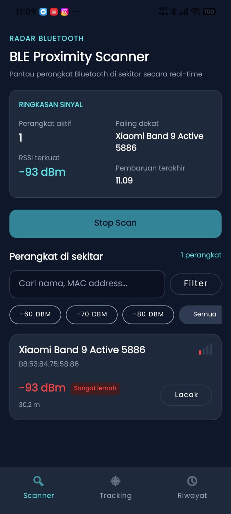
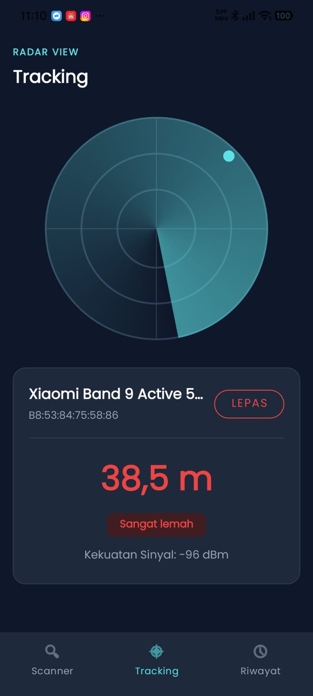
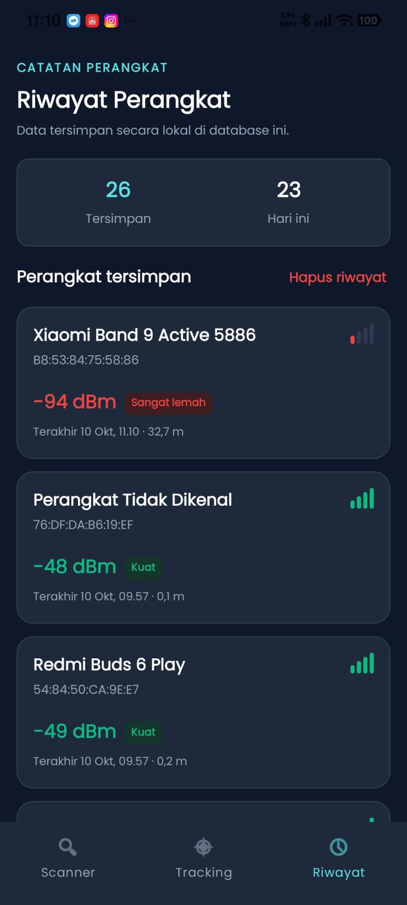

# BLE Proximity Radar 📡

A robust, real-time Android application designed to scan, filter, and track Bluetooth Low Energy (BLE) devices. This project was developed as a technical showcase for the Mobile Engineer Study Case, focusing on clean architecture, modern Android development practices, and resilient edge-case handling.

---

## 🌟 Key Features

*   **Real-Time Scanner:** Discovers active BLE devices nearby, displaying their MAC Address, Name, raw RSSI (dBm), and estimated distance.
*   **Smart Filtering:** Sorts devices automatically by signal strength and allows manual filtering via search queries (Name/MAC) and RSSI thresholds (e.g., ≥ -80 dBm).
*   **Dynamic Radar View (Tracking):** A dedicated tracking screen providing a highly visual, animated radar interface. It maps the target device's estimated distance in real-time and dynamically changes color/status based on signal strength categories (Strong, Good, Weak, Lost).
*   **Local History Logging:** Automatically persists previously discovered and tracked devices using a local database, providing a summary of saved devices and a timestamp of when they were last seen.
*   **Resilient Edge-Case Handling:** Gracefully handles permission denials, disabled Bluetooth states, and sudden device disconnections (out-of-range timeout logic).

---

## 📸 Screenshots

| Scanner Dashboard | Radar Tracking View | History Log |
| :---: | :---: | :---: |
|  |  |  |
---

## 🛠️ Tech Stack & Architecture

*   **Language:** Kotlin
*   **Architecture:** MVVM (Model-View-ViewModel) + Repository Pattern
*   **Dependency Injection:** Dagger Hilt
*   **Concurrency:** Kotlin Coroutines & StateFlow / Flow
*   **Local Database:** Room Database
*   **Navigation:** Jetpack Navigation Component (Bottom Navigation)
*   **UI Components:** Material Design Components (MDC)

### Architecture Rationale

1.  **MVVM Pattern:** Chosen for a clean separation of concerns. The UI (Fragments) only observes state, while the ViewModels handle the business logic and state management. This ensures UI components remain lightweight and testable.
2.  **Dagger Hilt:** Implemented for scalable Dependency Injection. It seamlessly manages the lifecycles of the `BleRepository`, `AppDatabase`, and `BluetoothAdapter`, preventing memory leaks and boilerplate code.
3.  **Coroutines & StateFlow:** Used for reactive programming. `StateFlow` is ideal for handling continuous streams of BLE scan results and UI states safely across lifecycle changes (like screen rotations).
4.  **Room Database:** Provides a robust abstraction layer over SQLite, allowing smooth, asynchronous inserts and queries for the History Log feature without blocking the main thread.

---

## 🚀 Setup & Installation

**Important:** BLE scanning requires a physical Android device. Emulators generally do not support Bluetooth hardware features.

1.  **Clone the repository:**
    ```bash
    git clone https://github.com/ohyuna56na/ble-proximity-radar.git
    ```
2.  **Open the project:**
    Open Android Studio, select `File > Open`, and choose the cloned repository folder.
3.  **Sync Gradle:**
    Allow Android Studio to download dependencies and sync the project.
4.  **Build and Run:**
    Connect a physical Android device (Android 6.0 / API 23 or higher) via USB or Wireless Debugging. Click the **Run** button (Shift + F10).
5.  **Testing Beacon Signals:**
    To test the radar effectively, use a second smartphone and install an app like **nRF Connect** or **BLE Simulator** to broadcast a BLE Advertising packet.

---

## ⚠️ Known Issues & Limitations

*   **"Unknown Device" Names:** Many BLE devices broadcast advertising packets without a human-readable name to save power/bandwidth. The app will display "Perangkat Tidak Dikenal" in these cases. Retrieving the actual name often requires establishing a full GATT connection, which is outside the scope of passive advertising scanning.
*   **Distance Estimation Variance:** The estimated distance (in meters) is calculated using a standard path-loss formula based on RSSI. Environmental factors (walls, human bodies, metal objects) and the broadcasting power of different hardware will cause fluctuations in accuracy.

---

## 🧠 Technical Assumptions & Constraints

1.  **Passive Scanning:** The application is designed to solely listen for BLE advertising packets (Passive Scanning). It does not initiate pairing or GATT connections (Bluetooth Classic is excluded).
2.  **Out-of-Range Timeout:** An assumption is made that if a previously tracked device does not update its advertising packet within **10 seconds**, it is considered "Out of Range" or "Lost".
3.  **Permissions:** The app assumes Android 12+ (API 31+) permission models (`BLUETOOTH_SCAN`, `BLUETOOTH_CONNECT`) alongside legacy location permissions (`ACCESS_FINE_LOCATION`) for older devices, handling both seamlessly.

---
